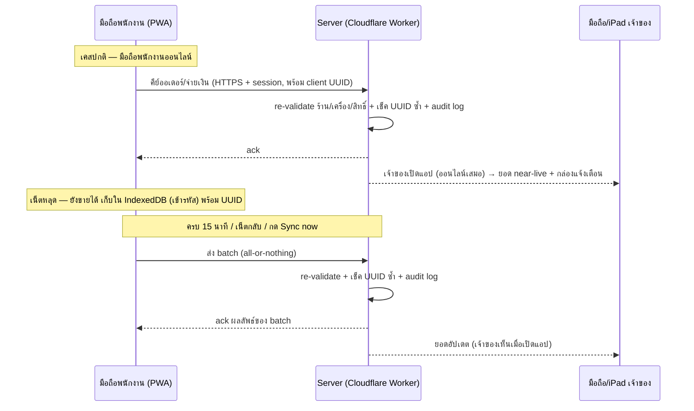
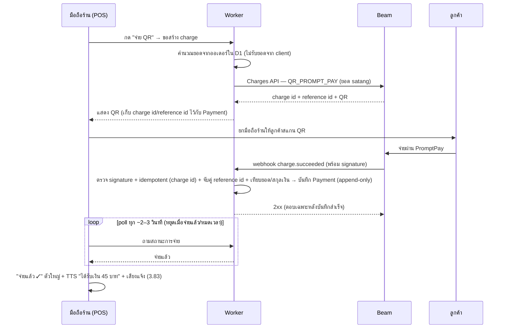

# FEATURES — POS ร้านข้าว (ข้าวราดแกง / อาหารตามสั่ง) — Multi-shop · PWA · พนักงานคีย์ออเดอร์

> **Draft v0.6**
>
> **v0.7 (ล่าสุด):** ใช้ **Beam Checkout (beamcheckout.com)** เป็น payment gateway ของ PromptPay (ฟรีสำหรับเจ้าของ) — PromptPay QR ต่อบิล **ยอดคิดฝั่ง server + ยืนยันอัตโนมัติด้วย webhook** (3.24, 3.82) และ**ประกาศเสียงโดย POS เอง** (3.83); **ตัดการรับสลิปโอน (3.25) และแอปธนาคาร/MacroDroid ออก** เพราะ API ตรวจสลิป/webhook ของธนาคารแพงเกินไป (7.26–7.27); 3.K เขียนใหม่เป็น "ยืนยันการจ่าย & ประกาศเสียง (Beam webhook)" + เพิ่ม 3.92 (Beam reconciliation) — **ไม่ renumber ข้อเดิม**
>
> **v0.6.2:** พนักงานใช้มือถือ Android ของร้าน (ร้านละเครื่อง) แทนมือถือส่วนตัว — ตัด iOS ฝั่งพนักงาน, แอปธนาคาร + MacroDroid อยู่บนเครื่องร้าน (3.52, 3.57–3.58, 3.83, 3.85)
>
> **v0.6.1:** ประกาศเงินเข้า = แอปร้านค้าธนาคารบนมือถือพนักงาน (3.82–3.83) · แต้มแยกต่อร้าน ตั้งค่าได้ทั้งตามยอดเงิน/ตามจำนวนจาน · ลูกค้าล็อกอินเองด้วย LINE Login + QR สมาชิก (3.87–3.90)
>
> **v0.6:** เพิ่ม 3.K ประกาศเสียงเงินเข้าผ่านแอปภายนอกฟรีบน Android (3.82–3.85) · เพิ่ม 3.L สะสมแต้มลูกค้า [Phase 2] เจ้าของเปิด/ปิดได้ต่อร้าน (3.86–3.91) · ไม่ได้ renumber ข้อเดิม
>
> **v0.5:** ปริมาณจริง 20–100 ออเดอร์/วัน/ร้าน → free tier เหลือเฟือ, retention ขยายเป็น 12 เดือน (3.78) · มีรูปเมนู 10–15 รูป/ร้าน (3.2, 3.79) · ใช้โดเมนตัวเองที่อยู่บน Cloudflare (3.75) · แจ้งเตือนเจ้าของ = ของใกล้หมด + ยอดรายวัน + สรุปวัน/สัปดาห์/เดือน (3.62)
> วิธีอ้างอิงตอนตัด/เพิ่ม: บอกเลขหัวข้อ เช่น "ตัด 3.4", "เพิ่มใน 5", "3.2 เอาไว้ก่อน"
> Priority: **[MVP]** = ต้องมีวันเปิดร้าน / **[Phase 2]** = ทำต่อหลังเสถียร / **[Nice-to-have]** = มีเวลาค่อยทำ

### เปลี่ยนจาก v0.3
- **ร้านละพนักงาน 1 คน กะเดียว มือถือ 1 เครื่อง** (2 ร้านเปิด-ปิดคนละเวลา) — ตัด realtime multi-device และ "เสียงเตือนเมื่อเครื่องอื่นคีย์" ออกจาก MVP เหลือบรรทัดเดียว [Phase 2] (3.20); ตัดข้อจำกัด "เครื่องอื่นไม่เห็นออเดอร์ของเครื่องที่ออฟไลน์" ที่ไม่เกี่ยวอีกต่อไป
- **Sync เรียบง่ายลง:** ออนไลน์ = push ทุกออเดอร์/การจ่ายขึ้น server ทันที เพื่อให้**เจ้าของเห็นยอด near-live บนเครื่องตัวเอง**; ออฟไลน์ = เก็บในเครื่อง + batch-sync ทุก 15 นาที / เน็ตกลับ / Sync now (3.68–3.74) — **คง security ทั้งชุด** (client UUID idempotency, batch all-or-nothing + ack, HTTPS + session, re-validate + audit log, append-only, server wins)
- **พนักงานยกเลิกออเดอร์ "ที่ยังไม่จ่าย" ได้เอง** — ต้องใส่เหตุผล มี log เจ้าของเห็นใน "รายการยกเลิก" [MVP] (3.15, 3.47) เพราะปกติพนักงานอยู่คนเดียว; **คืนเงินบิลที่จ่ายแล้ว/ส่วนลด ยังเป็นสิทธิ์เจ้าของ** (อนุมัติระยะไกลทีหลัง [Phase 2])
- **Login = PIN 4–6 หลักต่อคน เจ้าของเป็นคนตั้ง/reset** + ล็อกชั่วคราวเมื่อผิด 5 ครั้ง + auto-lock หลัง idle X นาที (ตั้งค่าได้) [MVP] (3.53–3.54)
- **กะ/วันขายแยกตามร้าน** — เปิด-ปิดกะอิสระต่อร้าน รายงาน "วันขาย" นับตามเวลาเปิด-ปิดของร้านตัวเอง (3.33)
- **เพิ่ม subsection "งบ & ข้อจำกัด Free tier (Cloudflare)"** — self-host บน Cloudflare free plan (Pages + Workers + D1 + R2 + Cron Triggers), backup รายวัน → R2 + Time Travel, retention ~6 เดือน + roll-up เป็น daily summary + archive CSV/JSON ลง R2, dashboard ใช้งาน vs ลิมิต เตือนที่ ~70–80% (3.75–3.81)
- **แอปเจ้าของ = web app responsive บน iPhone/iPad เครื่องแยก** (ใช้บนคอมก็ได้) ออนไลน์อย่างเดียว — ตัดความกำกวม "backoffice web vs โหมดเจ้าของบนมือถือ"; แจ้งเตือนเจ้าของเป็น in-app list ก่อน [MVP], Web Push = [Phase 2] (3.60–3.63); **ข้อควรระวัง iOS Safari:** ระบบอาจล้างพื้นที่เก็บข้อมูล PWA ถ้าไม่ได้ใช้นาน → sync บ่อย **ห้ามยึดมือถือเป็นสำเนาเดียว**; ฝั่งพนักงาน = **Chrome Android 8+ และ iOS Safari** (3.52, 3.58)
- Flow (4), Data Model (5), ขอบเขต MVP (6), คำตอบ+คำถามเปิด (7) เขียนใหม่ตามโฉม v0.4

---

## 1. ภาพรวม
POS สำหรับ **ร้านข้าว/อาหารจานเดียวขนาดเล็ก หลายร้าน (ร้านแยกกัน)** (ข้าวราดแกง, อาหารตามสั่ง, ข้าวมันไก่) ที่ **แต่ละร้านมีพนักงานคนเดียวต่อกะ ใช้มือถือเครื่องเดียว** — คีย์ออเดอร์ ทำครัว เสิร์ฟ เก็บเงิน คนเดียวจบ (เจ้าของมักไม่อยู่หน้าร้าน) ทั้งกินที่ร้าน (เลขคิว หรือเลขคิว+โต๊ะ), กลับบ้าน และเดลิเวอรี่แอป (Grab/LINE MAN/Foodpanda — คีย์มือ)

**Platform & Hardware (self-host บน Cloudflare free plan):**
- **แอปพนักงาน = Web app (PWA):** static files บน **Cloudflare Pages** (หรือ Workers static assets), ทำงาน offline ด้วย **Service Worker + IndexedDB**; รันบน **มือถือ Android ของร้าน** (Chrome on Android 8+)
- **แอปเจ้าของ = web app responsive บนเครื่องแยก** (iPhone/iPad ผ่าน Safari, add-to-home-screen ได้, ใช้บนคอมก็ได้) — **ต้องออนไลน์ ไม่ทำ offline ฝั่งเจ้าของ**
- **API บน Cloudflare Workers + ข้อมูลใน D1 (SQLite) + รูป/backup/archive ใน R2 + งานตั้งเวลาผ่าน Cron Triggers** — เจ้าของเป็นเจ้าของบัญชี Cloudflare เอง; ใช้ subdomain ฟรี `*.pages.dev` / `*.workers.dev` ได้ (โดเมนตัวเอง optional — มีค่าใช้จ่าย)
- **ชำระเงินดิจิทัลผ่าน Beam Checkout (beamcheckout.com) — payment gateway:** Worker สร้าง PromptPay QR ต่อบิลผ่าน Charges API (payment type `QR_PROMPT_PAY`, ยอดส่งเป็น satang) — **PromptPay ฟรีสำหรับเจ้าของ**; ยืนยันจ่ายด้วย webhook `charge.succeeded` (Beam แนะนำใช้ webhook แทนการ polling); **เงินเข้า Beam ก่อน แล้วจ่ายออก T+1 วันทำการ** (ไม่เข้าบัญชีธนาคารทันที); บัตร 1.80%+ / e-wallet 2.20% — ไม่ใช้ใน MVP (3.30)
- **มือถือร้าน (Android) ร้านละเครื่อง:** พนักงานใช้มือถือที่ร้านจัดให้ ไม่ใช่มือถือส่วนตัว — ล็อกอินรายคนด้วย PIN + ลงทะเบียนเครื่องต่อร้าน เจ้าของอนุมัติ/เพิกถอนได้; **APK (TWA/Capacitor) sideload เท่านั้น ไม่ขึ้น Play Store** ไว้ภายหลัง (3.59)
- **Offline แบบเรียบง่าย:** ออนไลน์ = push ทุกออเดอร์/การจ่ายขึ้น server ทันที (เจ้าของเห็นยอด near-live); ออฟไลน์ = ขายต่อได้ เก็บในเครื่อง แล้ว batch-sync ทุก 15 นาที / เน็ตกลับ / กด Sync now (3.68–3.74)
- **ไม่มีเครื่องพิมพ์ ไม่ต้องซื้อ hardware** — บิล/ยอดรวม/PromptPay QR แสดงบนจอพนักงานทั้งหมด; **เป้าหมายต้นทุน: อยู่ใน Cloudflare free tier** ("ไม่ให้เต็ม free tier" — ลิมิต + นโยบายเก็บข้อมูล ดู subsection "งบ & ข้อจำกัด Free tier" ใต้ 3.J)

## 2. ผู้ใช้งาน / Roles

| สิทธิ์ | เจ้าของ (Owner) | พนักงาน (Staff) |
|---|:---:|:---:|
| คีย์ออเดอร์ทุกช่องทาง (หน้าร้าน/กลับบ้าน/เดลิเวอรี่) / คิดเงิน | ✅ | ✅ |
| เปลี่ยนสถานะคิว (กำลังทำ → เสร็จ/เสิร์ฟแล้ว → จ่ายแล้ว) / ของหมด toggle | ✅ | ✅ |
| **ยกเลิกออเดอร์ที่ยังไม่จ่าย** (ต้องใส่เหตุผล) | ✅ | ✅ — บันทึกผู้ยกเลิก+เหตุผล เจ้าของเห็นใน "รายการยกเลิก" |
| **คืนเงินบิลที่จ่ายแล้ว / ให้ส่วนลด** | ✅ (ทำจากแอปเจ้าของ) | ❌ — ขอได้ แต่เจ้าของอนุมัติระยะไกล [Phase 2] |
| ปิดกะ / ดูสรุปกะ | ✅ (ทุกร้าน) | ✅ (เฉพาะกะตัวเอง) |
| แก้เมนู/ราคา, ตั้งค่าร้าน | ✅ | ❌ |
| สต็อก (บันทึกรับของเข้า, ดูยอดประมาณ) | ✅ | ❌ (พนักงานไม่แตะสต็อก) |
| จัดการผู้ใช้ & อุปกรณ์ (ตั้ง/reset PIN, อนุมัติ/revoke) | ✅ | ❌ |
| สร้าง/จัดการร้าน (multi-shop), รายงานกำไร/เทียบร้าน | ✅ | ❌ |

หมายเหตุ: ร้านละพนักงานคนเดียวต่อกะ บนมือถือ Android ของร้านเครื่องเดียว — ทุกคนล็อกอินด้วย **PIN 4–6 หลัก** (3.53) ระบบจึงรู้ว่าใครคีย์/ยกเลิก/ปิดกะ; เพราะพนักงานอยู่คนเดียวจึงยกเลิกออเดอร์ที่ยังไม่จ่ายได้เอง**แต่ต้องมีเหตุผล**; คืนเงิน/ส่วนลดเป็นสิทธิ์เจ้าของ — ทำจากแอปเจ้าของ หรืออนุมัติระยะไกลทีหลัง [Phase 2]; การจ่ายด้วย Beam QR ยืนยัน**อัตโนมัติ**จาก webhook (3.82) — **พนักงานไม่ต้องกด "ชำระแล้ว"** สำหรับ QR (เงินสด และทางสำรอง 3.85 ยังเป็นพนักงานกดยืนยันเอง)

## 3. Feature List (แยกตาม Module)
### 3.A เมนู & สินค้า (Menu Management — แยกต่อร้าน)
- **3.1** หมวดหมู่เมนู (ข้าวราดแกง / อาหารตามสั่ง / เครื่องดื่ม / ของทานเล่น) เรียงปุ่มกดได้ **[MVP]**
- **3.2** รายการอาหารตามสั่ง พร้อมราคา กดสั่งได้ใน 1–2 แตะ; **มีรูปเมนู** (10–15 เมนู/ร้าน) แสดงเป็นปุ่มรูป — บีบอัดอัตโนมัติตอนอัปโหลด (3.79) **[MVP]**
- **3.3** Option ต่อจาน: พิเศษ / ไข่ดาว / ไข่ต้ม / ไข่เจียว / เพิ่มข้าว / ไม่เผ็ด ไม่หอม ไม่ผักชี — ตั้งราคาบวกได้ **[MVP]**
- **3.4** ข้าวราดแกงราคาตามจำนวน: 1 / 2 / 3 อย่าง เลือกแกงแล้วคิดราคาอัตโนมัติ **[MVP]**
- **3.5** ปุ่ม "ของหมด" ต่อเมนู/แกงหม้อ — ปุ่มจางกดไม่ได้ที่หน้าขาย; เมื่อออนไลน์ push ขึ้น server ทันที **[MVP]**
- **3.6** ราคาต่างช่องทาง: หน้าร้าน vs Grab/LINE MAN/Foodpanda (markup % หรือบาท/จาน) เลือกช่องทางตอนคีย์ออเดอร์ **[MVP]**
- **3.7** เมนูเซ็ต/โปรโมชัน เช่น ข้าว+น้ำ 30.- **[Phase 2]**
- **3.8** เมนูช่วงเวลา เช่น ข้าวต้มขายเช้าเท่านั้น **[Phase 2]**
- **3.9** แก้ไขเมนู/ราคาจากแอปเจ้าของ (มือถือ/แท็บเล็ต/คอม) — คือแอปเดียวกัน ไม่มี "backoffice แยก" กับ "โหมดเจ้าของ" อีกต่อไป **[MVP]**
### 3.B การรับออเดอร์ (Ordering — พนักงานคีย์ทุกออเดอร์ คนเดียวจบ)
- **3.10** **คีย์ออเดอร์ 3 ประเภท:** กินที่ร้าน / กลับบ้าน / เดลิเวอรี่แอป — ลูกค้าไม่ได้คีย์เอง **[MVP]**
- **3.11** **เลขคิว/เลขบิลรันอัตโนมัติเป็น default** (เช่น B-17); **เลขโต๊ะเป็น field ที่ใส่ได้ถ้ามี** — ไม่มีก็ได้ ไม่มี floor plan **[MVP]**
- **3.12** ช่องหมายเหตุต่อจาน (ไม่เผ็ด, แยกน้ำแกง, ห่อกลับแยก) — แสดงในจอคิวออเดอร์ **[MVP]**
- **3.13** พักบิล (hold) หลายบิลพร้อมกัน เรียกกลับมาต่อได้ — ลูกค้าสั่งเพิ่ม/รอเพื่อน **[MVP]**
- **3.14** **เรียกคิว/เสิร์ฟ:** กด "เสร็จ" แล้วเลขคิวขึ้นใหญ่บนจอ — พนักงานเสิร์ฟโต๊ะ หรือลูกค้าเดินมารับเมื่อตะโกนเลขคิว **[MVP]**
- **3.15** **ยกเลิกออเดอร์ที่ยังไม่จ่าย (พนักงานทำเองได้):** ต้องกรอก**เหตุผล**ทุกครั้ง — ระบบบันทึกผู้ยกเลิก+เหตุผล และเจ้าของเห็นใน "รายการยกเลิก" (3.47) **[MVP]**
- **3.16** **เดลิเวอรี่คีย์มือ:** เลือกช่องทาง Grab/LINE MAN/Foodpanda ตอนคีย์ (ราคาตาม 3.6) — **ไม่เชื่อม API ของแอปเดลิเวอรี่ (มีค่าใช้จ่าย/ต้องเป็น partner) — คีย์มือเท่านั้น** **[MVP]**
- **3.17** ลูกค้าสแกน QR สั่งเอง — ไว้พิจารณาภายหลัง **[Phase 2]**
- **3.18** ออเดอร์ล่วงหน้า/จอง (pre-order พรุ่งนี้ 11:00) **[Phase 2]**
### 3.C คิวออเดอร์ & ครัว (Order Queue — จอเดียวจบ เพราะร้านละคนเดียว/เครื่องเดียว)
- **3.19** **จอคิวออเดอร์** บนมือถือ: สถานะ **กำลังทำ → เสร็จ/เสิร์ฟแล้ว → จ่ายแล้ว** ปุ่มใหญ่ ใช้มือเดียว ทำงานได้ทั้งยืนรับออเดอร์และอยู่ครัว **[MVP]**
- **3.20** หลายเครื่องต่อร้านแบบ realtime (ถ้าวันหน้ามีคน/เครื่องเพิ่ม) — ตัดออกจาก MVP เพราะร้านละคนเดียว **[Phase 2]**
- **3.21** รวมจานเดียวกันข้ามออเดอร์เพื่อทำเป็นชุด เช่น "ไข่ดาว x4, ข้าวขาว x6" **[Phase 2]**
- **3.22** จอคิวให้ลูกค้าเห็นหน้าร้าน (เลขคิวพร้อมรับ บนจอที่มีอยู่) **[Nice-to-have]**
### 3.D ชำระเงิน (Payment — จ่ายกับพนักงาน ไม่พิมพ์)
- **3.23** เงินสด: กรอกเงินรับ → ระบบคิดเงินทอน **[MVP]**
- **3.24** **PromptPay QR ต่อบิล ผ่าน Beam (beamcheckout.com):** POS สั่ง **Worker สร้าง Beam charge** ผ่าน Charges API (payment type `QR_PROMPT_PAY`, ยอดส่งเป็น **satang**) — **ยอดคำนวณฝั่ง server จากออเดอร์ใน D1 เท่านั้น ไม่รับยอดจาก client เด็ดขาด** (BFF pattern; Beam secret key เก็บเป็น Worker secrets ผ่าน `wrangler secret put` เท่านั้น); QR แสดงบนมือถือร้านให้ลูกค้าสแกน; **ยืนยันอัตโนมัติ** เมื่อ webhook `charge.succeeded` ถึง Worker (3.82) → ออเดอร์เปลี่ยนเป็น **"จ่ายแล้ว" เอง ไม่ต้องมีปุ่มให้พนักงานกดยืนยัน**; PromptPay ผ่าน Beam **ฟรีสำหรับเจ้าของ** — เงินเข้า Beam ก่อน แล้วจ่ายออก **T+1 วันทำการ** (ไม่เข้าบัญชีธนาคารทันที) **[MVP]**
- **3.25** ~~โอนเงิน/สลิป: พนักงานเช็คสลิปแล้วกดยืนยันเอง~~ — **~~ตัดออก~~ (v0.7: ไม่รับสลิปโอนอีกต่อไป — ลูกค้าจ่ายผ่าน Beam QR (3.24) หรือเงินสด; ทางสำรองแบบยืนยันด้วยมืออยู่ที่ 3.85)**
- **3.26** **บิล+ยอดรวมบนจอพนักงาน** — ไม่มีใบเสร็จ ไม่มีจอลูกค้า; จะให้ลูกค้าดูก็ยกมือถือให้ดู **[MVP]**
- **3.27** ส่วนลด: ต่อบิล (บาท/%) และต่อจาน — **เฉพาะเจ้าของ** **[MVP]**
- **3.28** **คืนเงิน/ยกเลิกบิลที่จ่ายแล้ว** — บันทึกเหตุผล **เฉพาะเจ้าของ** ทำจากแอปเจ้าของ **[MVP]**; **คืนเงินสำหรับบิลที่จ่ายผ่าน Beam ทำใน Beam dashboard โดยเจ้าของ** — POS บันทึกการคืนเงินตามนั้น; ส่วน "พนักงานกดขอ แล้วเจ้าของอนุมัติระยะไกล" = **[Phase 2]**
- **3.29** รวมหลายวิธีในบิลเดียว (สด+QR) **[Phase 2]**
- **3.30** **รับบัตร/e-wallet ผ่าน Beam** (บัตร 1.80%+ / e-wallet 2.20%) — **เปิดใช้ถ้าเจ้าของต้องการ** (ใช้บัญชี Beam เดียวกับ PromptPay 3.24; ไม่ใช้ใน MVP) **[Phase 2]**
### 3.E กะ & เงินสด (Shift & Cash — แยกอิสระต่อร้าน)
- **3.31** เปิดกะ: บันทึกเงินทอนตั้งต้น + ผู้เปิด **[MVP]**
- **3.32** ปิดกะ: นับเงินจริง → เทียบกับยอดขายเงินสด → แสดงส่วนต่าง **[MVP]**
- **3.33** **กะ/วันขายแยกตามร้าน:** 2 ร้านเปิด-ปิดคนละเวลา → เปิด-ปิดกะอิสระต่อร้าน; รายงาน "วันขาย" นับตามเวลาเปิด-ปิดของร้านตัวเอง (ข้ามเที่ยงคืนได้) **[MVP]**
- **3.34** บันทึก เติมเงิน/ถอนเงินระหว่างกะ (paid in/out) พร้อมเหตุผล **[Phase 2]**
- **3.35** สรุปปิดกะ Z-report ต่อกะ และ X-report ดูยอดไม่ปิดกะ — แสดงบนจอ **[MVP]**
### 3.F สต็อก & วัตถุดิบ (Inventory — เจ้าของดูแลคนเดียว พนักงานไม่แตะ)
- **3.36** **สูตรใช้ของโดยประมาณต่อจาน (StockUsage):** เจ้าของตั้งเอง เช่น ข้าวผัด 1 จาน ≈ ข้าว 1 ทัพพี + ไข่ 1 ฟอง; ราดแกง 1 อย่าง ≈ แกง 1/20 หม้อ **[MVP]**
- **3.37** **หักสต็อกโดยประมาณอัตโนมัติ** ตามจานที่ขายจริงทุกช่องทาง — **ย้ำ: ตัวเลขเป็น "ประมาณ"** เพราะพนักงานไม่ได้ชั่งตวงตอนทำ **[MVP]**
- **3.38** **เจ้าของบันทึกรับของเข้า (restock):** สั่งซื้อของออนไลน์/ซื้อเอง แล้วมาบันทึกเองในแอปเจ้าของ (item, จำนวน, ราคา/ผู้ขาย ถ้าใส่) + ประวัติ **[MVP]**
- **3.39** แจ้งเตือนใกล้หมด (low-stock) ตามยอดประมาณคงเหลือ เทียบ threshold ต่อร้าน — **ช่วงแรกเป็นรายการในแอปเจ้าของ (in-app list)**, push จริง = [Phase 2] (3.63) **[MVP]**
- **3.40** เจ้าของนับของจริง → เทียบ ประมาณ vs จริง (variance) → ปรับยอด — ไว้แก้ drift ของตัวเลขประมาณ **[Phase 2]**
- **3.41** ผูกกับปุ่มของหมด: แกงเหลือครึ่งหม้อ → เตือนให้ปัดของหมด **[Phase 2]**
- **3.42** สั่งซื้อวัตถุดิบ/พร้อมผู้ขาย ในระบบ **[Nice-to-have]**
### 3.G รายงาน (Reports — ต่อร้าน + รวมทุกร้าน ดูในแอปเจ้าของ)
- **3.43** สรุปยอดขายรายวัน/สัปดาห์/เดือน แยกวิธีจ่าย **[MVP]**
- **3.44** เมนูขายดี/ขายไม่ออก รายวัน-รายเดือน **[MVP]**
- **3.45** ยอดตามช่วงเวลา (peak hours) เพื่อเตรียมของ/จัดคน **[MVP]**
- **3.46** แยกยอดตามช่องทาง: หน้าร้าน (กินที่ร้าน/กลับบ้าน) / Grab / LINE MAN / Foodpanda **[MVP]**
- **3.47** **รายการยกเลิก:** ออเดอร์ที่ถูกยกเลิก (ยังไม่จ่าย) และบิลที่คืนเงิน — ใคร อะไร เมื่อไหร่ เหตุผลอะไร **[MVP]**
- **3.48** ประวัติ variance สต็อก (ประมาณ vs จริง) **[Phase 2]**
- **3.49** กำไรขั้นต้นคร่าวๆ (ราคาขาย − ต้นทุนต่อจานที่กรอกเอง) + เทียบร้าน **[Phase 2]**
- **3.50** Export CSV (รวมดึงข้อมูลเก่าจาก archive ใน R2 ได้) **[Phase 2]**
### 3.H อุปกรณ์ (Devices — PWA บนมือถือ Android ของร้าน ร้านละ 1 เครื่อง)
- **3.51** **PWA ติดตั้งได้:** เปิดลิงก์ → "Add to Home screen" → ใช้เหมือนแอป; **ทำงาน offline ด้วย Service Worker + IndexedDB** **[MVP]**
- **3.52** **มือถือร้าน Android:** เป้า **Chrome on Android 8+** (ไม่ต้องรองรับ iOS ฝั่งพนักงาน); UI เบา/ปุ่มใหญ่สำหรับมือถือรุ่นต่ำ; ตั้งให้จอไม่ดับระหว่างเปิดร้าน **[MVP]**
- **3.53** **Login ด้วย PIN 4–6 หลักต่อคน; เจ้าของเป็นคนตั้ง/reset PIN เท่านั้น** — track ว่าใครคีย์/ยกเลิก/ปิดกะ **[MVP]**
- **3.54** **กันเดา PIN + auto-lock:** ผิด 5 ครั้ง → ล็อกชั่วคราวไม่กี่นาที; ไม่ใช้งานนาน X นาที (ตั้งค่าได้) → ล็อก ต้องใส่ PIN ใหม่ **[MVP]**
- **3.55** **ลงทะเบียนอุปกรณ์ต่อร้าน:** มือถือที่ยังไม่ได้รับการอนุมัติเข้าไม่ได้ — เจ้าของกดอนุมัติก่อน **[MVP]**
- **3.56** **Revoke ระยะไกล:** พนักงานลาออก/เครื่องหาย → เจ้าของเพิกถอนจากแอปเจ้าของ → เครื่องนั้นถูกล็อกและข้อมูลร้านถูกลบเมื่อต่อเน็ตครั้งถัดไป **[MVP]**
- **3.57** **Logout ล้างข้อมูลในเครื่อง** (เปลี่ยนคน/เปลี่ยนเครื่อง ไม่เหลือข้อมูลค้าง — ต้อง sync ครบก่อน logout) **[MVP]**
- **3.58** **เก็บข้อมูลในเครื่องให้น้อยที่สุด** (เฉพาะออเดอร์วันนี้ + เมนู) — server เป็นสำเนาหลักเสมอ ห้ามยึดมือถือเป็นสำเนาเดียว (มือถือหาย/เสีย = ข้อมูลที่ sync แล้วไม่หาย) **[MVP]**
- **3.59** **APK ภายหลัง:** ห่อ PWA (TWA/Capacitor), **sideload เท่านั้น ไม่ขึ้น Play Store** **[Phase 2]**
### 3.I แอปเจ้าของ (Owner App — web app responsive บน iPhone/iPad เครื่องแยก ใช้บนคอมก็ได้)
- **3.60** **Owner web app:** เปิดใน Safari ได้ทั้ง iPhone/iPad + เบราว์เซอร์บนคอม; add-to-home-screen ได้ — **ต้องออนไลน์เสมอ (ไม่ทำ offline ฝั่งเจ้าของ)** **[MVP]**
- **3.61** **ดูยอด near-live ระหว่างวัน:** ยอดขาย/จำนวนบิล/แยกช่องทาง ทุกร้าน — อัปเดตจากที่พนักงาน push ขึ้น server (3.68) **[MVP]**
- **3.62** **กล่องแจ้งเตือน in-app (ตามที่เจ้าของเลือก):** (1) **ของใกล้หมด** (3.39) (2) **ยอดต่อวันของแต่ละร้าน** — ขึ้นเมื่อร้านปิดกะ (3) **สรุปยอดรวม รายวัน / รายสัปดาห์ / รายเดือน** ทุกร้าน (สร้างโดย Cron 3.76) — ดูย้อนหลังได้; รายการยกเลิกดูในรายงาน 3.47 (ไม่เด้งแจ้งเตือน) **[MVP]**
- **3.63** **Web Push จริง (low-stock, มีการยกเลิกบิล, ปิดกะ):** บน iOS ต้อง add-to-home-screen (iOS 16.4+) เท่านั้น — เลยทำ in-app list ก่อน (3.62) **[Phase 2]**
### 3.J ตั้งค่า & ระบบ (Settings & System — Multi-shop, Offline & Sync, Free tier)
- **3.64** **Multi-shop:** รองรับ 2 ร้านขึ้นไป — แต่ละร้านแยก **เมนู, ผู้ใช้/อุปกรณ์, เลขคิว, กะ, สต็อก, รายงาน** ของตัวเอง; เจ้าของสลับ/ดูได้ทุกร้าน **[MVP]**
- **3.65** จัดการร้าน: สร้าง/แก้ร้าน (ชื่อ, ที่อยู่, เบอร์, PromptPay, **เวลาเปิด-ปิด**), ตั้งค่าต่อร้าน (sync interval, threshold สต็อก, นาที auto-lock) **[MVP]**
- **3.66** ผู้ใช้ & สิทธิ์ ตามตารางข้อ 2 (รวมตั้ง/reset PIN) **[MVP]**
- **3.67** ภาษาไทย UI ถูกต้องทั้งระบบ **[MVP]**
#### Offline & Sync (ออนไลน์ = push ทันที / ออฟไลน์ = batch)
- **3.68** **Push ทันทีเมื่อออนไลน์:** ออเดอร์/สถานะ/การชำระเงิน/ของหมด ส่งขึ้น server ทันทีที่บันทึก — เพื่อให้เจ้าของเห็นยอด near-live บนเครื่องตัวเอง **[MVP]**
- **3.69** **ออฟไลน์ขายต่อได้:** งานบนเครื่องนั้นเก็บใน **IndexedDB (เข้ารหัส)** แล้ว **batch-sync ทุก 15 นาที (เมื่อมีเน็ต) / ทันทีเมื่อเน็ตกลับ / กด "Sync now"** **[MVP]**
- **3.70** ทุก record มี **UUID สร้างบนเครื่อง (client-generated)** → ส่งซ้ำ/retry กี่ครั้งก็ไม่เกิดออเดอร์ซ้ำ (idempotent) **[MVP]**
- **3.71** **Batch เป็น all-or-nothing ต่อ batch** + server ตอบ **ack**; ทุก request ผ่าน **HTTPS + การยืนยันตัวเครื่อง/ผู้ใช้ (device/session)** **[MVP]**
- **3.72** Server **ตรวจซ้ำ (re-validate)** สิทธิ์ทุกครั้ง (ร้าน/เครื่อง/permission ตรงกับข้อมูลไหม) และเก็บ **audit log** ทุก batch **[MVP]**
- **3.73** **กติกา conflict:** เมนู/ราคา = **server wins**; ออเดอร์/การชำระเงิน = **append-only** ไม่มีการเขียนทับ **[MVP]**
- **3.74** **ตัวบอกสถานะ sync:** ไอคอน + จำนวน record ค้าง sync + เวลา sync ล่าสุด; **เตือน** ถ้าค้างนานเกินกำหนด **[MVP]**
#### งบ & ข้อจำกัด Free tier (Cloudflare) — เป้าคือ "ไม่ให้เต็ม free tier"
- **3.75** **Self-host บน Cloudflare free plan:** PWA static files บน **Pages** (หรือ Workers static assets), API บน **Workers**, ข้อมูลใน **D1 (SQLite)**, รูป/backup/archive ใน **R2**; **เจ้าของเป็นเจ้าของบัญชี Cloudflare**; **ใช้โดเมนของเจ้าของที่อยู่บน Cloudflare แล้ว** (ไม่มีค่าใช้จ่ายเพิ่ม) เช่น `pos.<domain>` (พนักงาน), `owner.<domain>` (เจ้าของ), `api.<domain>` (Worker) — ชื่อ subdomain จริงค่อยกำหนด **[MVP]**
- **3.76** **Scheduled jobs ผ่าน Cron Triggers:** export ข้อมูล → R2 รายวัน, roll-up daily summary รายวัน, เก็บกวาดตาม retention **[MVP]**
- **3.77** **Backup:** export D1 เป็นไฟล์ขึ้น R2 ทุกวัน + **D1 Time Travel** (point-in-time restore; **หน้าต่างเวลาบน free plan จำกัด — ต้อง verify ก่อนทำ**) **[MVP]**
- **3.78** **Retention policy:** เก็บออเดอร์ raw ใน D1 **~12 เดือน (ตั้งค่าได้)** → ที่เก่ากว่านั้น **roll-up เป็นตารางสรุปรายวัน** (ยอดต่อวัน/ต่อเมนู/ต่อช่องทาง — เก็บไปเรื่อยๆ) + **archive raw เป็น CSV/JSON บีบอัดลง R2** (ยัง export ได้) **[MVP]**
- **3.79** **รูปเมนูใน R2:** ย่อ/บีบอัดเป็น WebP (~50–100 KB/รูป) ตอนอัปโหลด → ~30 รูปรวม ≈ 3 MB (จิ๊บๆ เทียบ 10 GB); รูปถูก cache ใน Service Worker ให้หน้าขายโหลดเร็วและใช้ได้ตอนออฟไลน์ (3.2) **[MVP]**
- **3.80** **Dashboard ใช้งาน vs ลิมิต:** แสดงขนาด DB + requests วันนี้ให้เจ้าของดู **เตือนที่ ~70–80%** ของลิมิต **[MVP]**
- **3.81** **D1 แยกฐานข้อมูลต่อร้าน** — กระจายลิมิต 500 MB/ฐานข้อมูล **[Phase 2]**

ลิมิต free tier ของ Cloudflare (ตัวเลข ณ วันที่เขียน — **ต้องเช็คซ้ำกับ docs ล่าสุดก่อนเริ่มทำ**):

| บริการ | ลิมิต free tier |
|---|---|
| Workers | 100,000 requests/วัน |
| D1 | 500 MB/ฐานข้อมูล, 5 GB รวมต่อบัญชี, 5M rows read/วัน, 100k rows written/วัน |
| R2 / Pages | R2 10 GB storage; Pages static hosting ฟรี |

**คำนวณคร่าวๆ (ตัวเลขจริงจากเจ้าของ: 20–100 ออเดอร์/วัน/ร้าน):** กรณีสูงสุด 100 × 2 ร้าน × ~5 แถว (order + ~3 items + payment) ≈ **~1,000 rows เขียน/วัน (1% ของลิมิต 100k)** + requests ราว 1–3 พัน/วัน (1–3% ของ 100k); พื้นที่ ~0.5–1 KB/แถว → **~0.2–0.35 GB/ปี ในกรณีสูงสุด** → อยู่ใต้ 500 MB ได้ราว 1.5–2 ปีแม้ไม่ลบอะไร — retention 12 เดือน + roll-up (3.78) จึงเป็นแค่กันเหนียว; รูปเมนู ~3 MB ใน R2 (3.79)

### 3.K ยืนยันการจ่าย & ประกาศเสียง (Beam webhook)
- **3.82** **Webhook handler บน Worker** — Beam ส่ง `charge.succeeded` มาที่ Worker (Beam แนะนำใช้ webhook แทนการ polling): **ตรวจ signature ของ webhook ทุกครั้ง** — ตาม [docs](https://docs.beamcheckout.com/webhook-authentication): header `X-Beam-Signature` = base64(HMAC-SHA256(**raw body ตามที่ได้รับ ห้าม parse แล้ว serialize ใหม่**, key ที่ base64-decode จาก Beam Lighthouse)) เทียบแบบ constant-time; docs ไม่มี timestamp กัน replay → พึ่ง idempotency ด้านล่างแทน; **idempotent ด้วย Beam charge id** (webhook ซ้ำกี่ครั้งก็ไม่เกิดผลซ้ำ); จับคู่กับออเดอร์ด้วย **reference id ที่เก็บไว้ตอนสร้าง charge** (3.24); ตรวจ **ยอดเงิน + สกุลเงินตรงกับออเดอร์**; เขียน Payment แบบ **append-only**; **ตอบ 2xx เฉพาะหลังบันทึกสำเร็จแล้ว**; เก็บ event ดิบไว้ตรวจสอบในตาราง **WebhookEvent** (ข้อ 5) **[MVP]**
  - **ข้อเท็จจริงจาก docs Beam:** auth = HTTP Basic (merchant ID + API key) เก็บใน Worker secret; Playground `https://playground.api.beamcheckout.com` / Production `https://api.beamcheckout.com`; charge QR ตอบ `actionRequired: "ENCODED_IMAGE"` + `encodedImage.imageBase64Encoded` + **`encodedImage.expiry`** (ใช้นับถอยหลังบนจอ); event `charge.succeeded` / `charge.failed`; webhook ที่ไม่ได้ 2xx จะ **retry 10 ครั้งแบบ exponential backoff** — ถ้า poll เอง (3.83) ใช้ backoff กัน `429`; ใส่ idempotency key ตอนสร้าง charge ([idempotency](https://docs.beamcheckout.com/get-started/idempotency-request)) กันกดจ่ายซ้ำสร้าง charge ซ้อน
  - **ความผิดพลาดฝั่ง Beam (network error / 5xx) = "ยังไม่รู้ผล" (undecidable)** — ห้ามถือว่า "ยังไม่จ่าย" หรือยกเลิกบิลจากเหตุผลนั้น; เปลี่ยนสถานะออเดอร์เฉพาะผลที่ชัดเจน (definitive) เท่านั้น
- **3.83** **ประกาศเสียงโดย POS เอง** — ระหว่างแสดง QR มือถือร้าน **poll สถานะการจ่ายแบบสั้น ทุก ~2–3 วินาที** (หยุดเมื่อจ่ายแล้ว/หมดเวลา — request เล็กมากเทียบกับโควตา Workers free tier) → เมื่อจ่ายแล้ว มือถือร้านขึ้น **"จ่ายแล้ว ✓" ตัวใหญ่** + พูดผ่าน **Web Speech API (TTS ภาษาไทย)** เช่น **"ได้รับเงิน 45 บาท"** + เสียงแจ้ง; **ไม่ต้องมีแอปธนาคาร ไม่ต้องมี MacroDroid** **[MVP]**
- **3.84** **QR หมดอายุ / ยกเลิก / สร้างใหม่** — ลูกค้าใช้เวลานานเกินไป หรือ **ยอดเปลี่ยน** (สั่งเพิ่มระหว่างรอ) → **สร้าง charge ใหม่** และถือว่า charge เดิมไม่ถูกใช้แล้ว; **webhook ที่มาช้าของ charge เก่า กระทบออเดอร์ที่จ่ายแล้ว** → ตั้งธงให้เจ้าของตรวจ (อาจจ่ายซ้ำ → คืนเงินผ่าน Beam dashboard, 3.28) **[MVP]**
- **3.85** **ทางสำรองเมื่อเน็ตหลุดหรือ Beam ล่ม** — ใช้ **เงินสด**; หรือ **รูป QR PromptPay ธนาคารแบบ static** (เจ้าของอัปโหลดต่อร้าน) โดยพนักงานยืนยันจาก **แจ้งเตือนธนาคารของเจ้าของ** — บันทึกใน Payment ว่า **"ยืนยันด้วยมือ (สำรอง)"** และขึ้นรายการให้เจ้าของตรวจ; **MacroDroid ไม่จำเป็นอีกต่อไป** (เอาออกจาก Phase 2 แล้ว) **[MVP]**
- **3.92** **Beam reconciliation report** — เทียบยอด **payout จาก Beam (T+1 วันทำการ)** กับยอด PromptPay รวมใน POS เป็นรายวัน **[Phase 2]**
  *(3.92 คือข้อใหม่ที่ต่อท้ายโมดูลนี้ — เลขต่อจาก 3.L ซึ่งจบที่ 3.91; ไม่ renumber ข้อเดิม)*

### 3.L สะสมแต้มลูกค้า (Loyalty — เจ้าของเปิดเมื่ออยากเรียกยอด)
- **3.86** **สวิตช์เปิด/ปิดต่อร้าน** — เจ้าของเปิดช่วงอยากเรียกยอด ปิดแล้วแต้มเดิมยังอยู่ (เปิดใหม่ใช้ต่อได้) **[Phase 2]**
- **3.87** **ลูกค้าล็อกอินเอง ด้วย LINE Login (ฟรี ไม่มีค่า SMS)** ที่หน้าเว็บสมาชิก `member.<domain>` → ได้ **QR สมาชิก** บนมือถือตัวเอง → ตอนจ่าย **พนักงานสแกน QR สมาชิกด้วยกล้องมือถือ** → ได้แต้ม/แลกแต้ม; ยอมรับเงื่อนไขเก็บข้อมูล (PDPA) ตอนสมัคร; สำรอง: พนักงานกรอกเบอร์โทรแทนถ้าลูกค้าไม่มี LINE **[Phase 2]**
- **3.88** **แต้มแยกต่อร้าน + กติกาตั้งค่าได้ต่อร้าน:** (a) **ตามยอดเงิน** เช่น 10 บาท = 1 แต้ม, 50 แต้ม = ลด 20 บาท หรือ (b) **ตามจำนวนจาน** เช่น กินครบ X จาน ได้ฟรี Y จาน (เลือกได้ว่านับเมนูไหน); ตั้งได้ว่าเดลิเวอรี่ได้แต้มไหม + วันหมดอายุแต้ม **[Phase 2]**
- **3.89** **แลกแต้มตอนจ่าย** เป็นส่วนลด/จานฟรี ตามกติกาที่เจ้าของตั้ง — พนักงานทำได้เอง (ไม่ต้องใช้สิทธิ์เจ้าของ) มี log **[Phase 2]**
- **3.90** **ลูกค้าดูแต้ม/ประวัติเอง** ในหน้าเว็บสมาชิก (แยกแต่ละร้าน) หลังล็อกอิน LINE — ไม่ต้องลงแอป ไม่ใช้ SMS OTP **[Phase 2]**
- **3.91** **รายงานโปรแต้ม:** จำนวนลูกค้าสะสม, แต้มแจก/แลก, ยอดขายช่วงเปิด vs ปิดโปร — ดูว่าเรียกยอดได้จริงไหม **[Phase 2]**

## 4. Flow หลัก
### 4.1 พนักงานรับออเดอร์ (กินที่ร้าน / กลับบ้าน) — คนเดียวจบ
1. ล็อกอิน (PIN) → เลือกประเภท: กินที่ร้าน / กลับบ้าน — ระบบตั้ง **เลขคิว** ให้อัตโนมัติ (ใส่เลขโต๊ะเพิ่มได้ถ้ามี)
2. กดเมนู + option + หมายเหตุ → ส่ง → ออเดอร์ขึ้น **"กำลังทำ"** บนจอคิวเครื่องเดียวกัน (ถ้าออนไลน์ push ขึ้น server ทันที เจ้าของเห็นยอด)
3. ทำเสร็จกด **"เสร็จ/เสิร์ฟแล้ว"** → เลขคิวขึ้นใหญ่ → เสิร์ฟโต๊ะ หรือตะโกนเลขคิวให้ลูกค้ามารับ
4. จ่ายกับพนักงาน: สด (กรอกเงินรับ → คิดทอน → กด **"จ่ายแล้ว"**) หรือ **PromptPay QR ผ่าน Beam บนมือถือร้าน** — **ยืนยันอัตโนมัติ** เมื่อ webhook ถึง (3.82) แล้วมือถือร้าน **ประกาศเสียง "ได้รับเงิน 45 บาท"** (3.83) พนักงานไม่ต้องกดยืนยัน (ขั้นตอนเต็มดู 4.7); ไม่รับสลิปโอน (3.25 ตัดออก); เน็ตหลุด/Beam ล่ม → ทางสำรอง 3.85 (บิล+ยอดอยู่บนจอ ไม่พิมพ์); ถ้าเปิดโปรแต้ม (Phase 2) ถามเบอร์ลูกค้าเพื่อสะสม/แลกแต้ม
5. **ยกเลิก (ยังไม่จ่าย):** ลูกค้ายกเลิก/คีย์ผิด → กด "ยกเลิกออเดอร์" → **กรอกเหตุผล** → ออเดอร์ติดสถานะ "ยกเลิก" (ไม่นับยอด) เจ้าของเห็นใน "รายการยกเลิก" (3.15, 3.47); **คืนเงินบิลที่จ่ายแล้ว = เจ้าของเท่านั้น** (3.28)
### 4.2 ออเดอร์เดลิเวอรี่ (คีย์มือ)
1. ออเดอร์เข้ามาในแอปเดลิเวอรี่ (บนมือถือพนักงานเครื่องนั้น) → เปิด POS เลือกช่องทาง Grab/LINE MAN/Foodpanda → คีย์เมนู (ราคา/markup ตาม 3.6 อัตโนมัติ)
2. ทำเสร็จกด "เสร็จ" → รอไรเดอร์มารับ → กด "จ่ายแล้ว" (บันทึกเป็นยอดผ่านแอปเดลิเวอรี่); **ไม่เชื่อม API — คีย์มือทุกออเดอร์** ปลายวันเทียบยอดแยกช่องทางในรายงาน (3.46) กับที่แอปแจ้ง
### 4.3 เน็ตหลุด → sync (แบบเรียบง่าย)
1. ขายต่อได้ทั้งวัน ข้อมูลเก็บในเครื่อง (เข้ารหัส); ไอคอน sync เหลือง "รอ sync N รายการ"
2. เน็ตกลับ (หรือครบ 15 นาที / กด Sync now) → ส่ง batch อัตโนมัติ → server ack → ไอคอนเขียว + last sync อัปเดต → เจ้าของเห็นยอดครบในแอปตัวเอง
### 4.4 ปิดกะ (close shift) — ต่อร้าน
1. แต่ละร้านปิดกะตามเวลาของตัวเอง (ร้าน A อาจปิด 15:00 ร้าน B ปิด 20:00) → กด "ปิดกะ" → นับเงินจริง → กรอกยอด
2. ระบบแสดง Z-report บนจอ: ยอดขายรวม / เงินสดที่ควรมี / ส่วนต่าง — เจ้าของเห็น "วันขาย" ของแต่ละร้านแยกกันในแอปเจ้าของ (3.33)
3. ถ้ามีรายการค้าง sync → เตือนให้กด "Sync now" ก่อนจบกะ
### 4.5 เจ้าของบันทึกของที่สั่งซื้อ + ดูสต็อกประมาณ
1. เจ้าของสั่งซื้อวัตถุดิบออนไลน์/ซื้อเอง (นอกระบบ)
2. ของถึงร้าน → แอปเจ้าของ → "บันทึกรับของเข้า" → item + จำนวน (+ ราคา/ผู้ขาย ถ้าใส่) → ยอดสต็อกเพิ่ม
3. ระหว่างวัน ระบบ**หักตามจานที่ขายโดยประมาณ** (ตามสูตร 3.36) — ตัวเลขคงเหลือจึงเป็น **"ประมาณ"** ไม่ใช่ของจริง 100%; เหลือต่ำกว่า threshold → ขึ้นในกล่องแจ้งเตือนของแอปเจ้าของ (3.62) — การนับของจริงแก้ drift ไว้ [Phase 2] (3.40)
### 4.6 พนักงานใหม่ / พนักงานลาออก
1. เจ้าของสร้างผู้ใช้ + **ตั้ง PIN 4–6 หลัก** ให้พนักงานใหม่ (ลืม PIN/สงสัยรั่ว → เจ้าของ **reset PIN** ให้ใหม่ — 3.53)
2. พนักงานใช้มือถือร้านเครื่องเดิม (ลงทะเบียนไว้แล้ว) → ล็อกอินด้วย PIN ของตัวเอง เริ่มงานได้; ลงทะเบียน+อนุมัติเครื่องทำแค่ตอนตั้งเครื่องร้านครั้งแรกหรือเปลี่ยนเครื่อง
3. พนักงานลาออก → เจ้าของ **ปิดผู้ใช้ (revoke user)** → PIN นั้นใช้ไม่ได้ทันทีที่เครื่องร้านต่อเน็ต; เครื่องร้านยังใช้ต่อได้กับพนักงานใหม่; **เครื่องหาย** → revoke เครื่อง → ล็อก + ลบข้อมูลร้านเมื่อต่อเน็ต (3.56)

### 4.7 จ่ายด้วย QR (Beam)
1. พนักงานกด **"จ่าย QR"** บนบิล → POS ขอ Worker สร้าง Beam charge — **ยอดคำนวณจากออเดอร์ใน D1 ฝั่ง server ไม่รับจาก client** (3.24)
2. **QR ขึ้นบนมือถือร้าน** ให้ลูกค้าสแกน; ระหว่างนั้นมือถือร้าน poll สถานะทุก ~2–3 วินาที (3.83)
3. ลูกค้าจ่าย → Beam ส่ง **webhook `charge.succeeded`** → Worker ตรวจ signature + idempotent (charge id) + จับคู่ reference id + เทียบยอด → บันทึก Payment (append-only) (3.82)
4. มือถือร้าน poll เห็น "จ่ายแล้ว" → ขึ้น **"จ่ายแล้ว ✓" ตัวใหญ่ + เสียงพูด "ได้รับเงิน 45 บาท"** — ออเดอร์เป็น "จ่ายแล้ว" อัตโนมัติ ไม่ต้องมีใครกดปุ่ม

## 5. ข้อมูลหลัก (Data Model คร่าวๆ)
- **Shop** — ชื่อร้าน, ที่อยู่, เบอร์, PromptPay, **เวลาเปิด-ปิด (ใช้นับกะ/วันขายต่อร้าน)**, การตั้งค่าต่อร้าน (sync interval, threshold สต็อก, นาที auto-lock)
- **User** — ชื่อ, role (owner/staff), **PIN hash + failed_attempts + locked_until (ล็อกพินผิด 5 ครั้ง)**, ร้านที่สังกัด (owner มองเห็นทุกร้าน), สถานะ (active/revoked)
- **Device** — shop_id, ชื่อ/รุ่นเครื่อง, device token, สถานะ (pending/approved/revoked), last sync
- **MenuItem** — shop_id, ชื่อ, หมวด, ราคาฐาน, ราคา/markup ต่อช่องทาง, รูป (optional), สถานะของหมด, ต้นทุนต่อจาน, ประเภท (ราดแกง/ตามสั่ง)
- **OptionGroup** — ชื่อกลุ่ม (เพิ่มไข่/ระดับเผ็ด), ตัวเลือกย่อย, ราคาบวก, required/optional
- **Order** — shop_id, **เลขคิว/เลขบิล**, ประเภท (dine-in/take-away/delivery), **โต๊ะ (optional)**, ช่องทาง (หน้าร้าน/กลับบ้าน/Grab/LINE MAN/Foodpanda), สถานะ (กำลังทำ → เสร็จ/เสิร์ฟแล้ว → จ่ายแล้ว / **ยกเลิก**), **cancel_reason + cancelled_by (เหตุผล+ผู้ยกเลิก)**, ส่วนลด, ยอดรวม, ผู้คีย์, กะ, เวลาสร้าง/ปิด, **client UUID**
- **OrderItem** — อ้าง MenuItem, option ที่เลือก, จำนวน, หมายเหตุ, ราคาต่อจาน ณ เวลาขาย (snapshot)
- **Payment** — อ้าง Order, วิธี (สด/PromptPay ผ่าน Beam/บัตร-e-wallet/เดลิเวอรี่แอป), ยอด, เงินรับ/ทอน, **beam_charge_id + reference_id** (จ่ายผ่าน Beam), **สถานะ (pending/succeeded/expired/manual)**, **confirmed_by (webhook/manual)**, ref, **client UUID**
- **Shift** — **shop_id (กะแยกตามร้าน)**, เวลาเปิด/ปิด, ผู้เปิด-ปิด, เงินตั้งต้น, เงินนับปิดกะ, ส่วนต่าง, ยอดแยกวิธีจ่าย, client UUID
- **StockItem** — shop_id, ชื่อวัตถุดิบ, หน่วย (ถุง/ทัพพี/ฟอง/หม้อ/ขวด), คงเหลือ **(โดยประมาณ)**, threshold แจ้งเตือน
- **StockUsage** — สูตรประมาณ: MenuItem → StockItem × ปริมาณต่อจาน (ข้าวผัด 1 จาน = ข้าว 1 ทัพพี + ไข่ 1 ฟอง)
- **StockPurchase** — รับของเข้า (restock): shop_id, วันที่, ผู้บันทึก (owner), รายการ item + จำนวน, ราคา/ผู้ขาย (ถ้าใส่), client UUID
- **StockCount** — *(Phase 2)* นับของจริง: วันที่, ผู้นับ, ยอดจริงราย item, ยอดประมาณ, variance, ยอดหลังปรับ
- **DailySummary** — **roll-up รายวันต่อร้าน:** วันขาย, ยอดรวม/แยกวิธีจ่าย/แยกช่องทาง, จำนวนบิล, ยอดยกเลิก, top เมนู — เก็บไปเรื่อยๆ หลัง raw หมด retention (3.78)
- **ArchiveFile** — ไฟล์ archive ใน **R2:** R2 key, ร้าน, ช่วงวันที่, ชนิด (CSV/JSON), ขนาด — ดึงกลับมา export ได้ (3.50, 3.78)
- **Customer** — *(Phase 2)* LINE user id, ชื่อแสดง, เบอร์โทร (optional/สำรอง), member QR token, ยินยอม PDPA เมื่อไหร่
- **LoyaltyRule** — *(Phase 2)* shop_id, เปิด/ปิด, ชนิด (ตามยอดเงิน/ตามจำนวนจาน), อัตราสะสม, เงื่อนไขแลก, เมนูที่นับ, เดลิเวอรี่ได้แต้มไหม, อายุแต้ม
- **PointTransaction** — *(Phase 2)* customer, shop_id (แต้มแยกต่อร้าน), order, ได้/แลก, จำนวนแต้มหรือจาน, วันหมดอายุ, client UUID
- **WebhookEvent** — event webhook จาก Beam เก็บดิบไว้ตรวจสอบ (audit + idempotency, 3.82): raw event id, received_at, processed, signature_ok
- **SyncBatch** — device, ช่วงเวลา, รายการ UUID ใน batch, สถานะ (pending/acked/failed), audit log

หมายเหตุ: record ที่เกิดบนมือถือ (Order/Payment/Shift/StockPurchase) มี **client UUID** เพื่อ idempotency; ข้อมูลหลัก (เมนู/ราคา) sync ทิศ server → device โดย **server wins**; ออเดอร์/การชำระเงินเป็น **append-only** (การยกเลิกก็ไม่ลบ — เก็บสถานะ+เหตุผล); ทุก entity ผูก **shop_id**; ไม่มี entity Table (Customer มาใน Phase 2 เพื่อสะสมแต้ม); ข้อมูลเก่าถูก roll-up เป็น DailySummary + เก็บเป็น ArchiveFile ตาม retention

## 6. ขอบเขต MVP สรุป
**ทำใน MVP:**
- [x] เมนู + หมวด + option + ราดแกง 1-2-3 อย่าง + ของหมด + ราคาต่อช่องทาง + แก้เมนูจากแอปเจ้าของ (3.1–3.6, 3.9)
- [x] พนักงานคีย์ทุกออเดอร์: 3 ประเภท + เลขคิว + โต๊ะ optional + หมายเหตุ + พักบิล + เรียกคิว + **ยกเลิกออเดอร์ที่ยังไม่จ่าย (มีเหตุผล)** + เดลิเวอรี่คีย์มือ (3.10–3.16)
- [x] จอคิว 3 สถานะ จอเดียวจบ (3.19); จ่ายกับพนักงาน: สด + **PromptPay QR ต่อบิลผ่าน Beam (ยืนยันอัตโนมัติ)** + บิลบนจอ + ส่วนลด/คืนเงิน (เจ้าของ) (3.23–3.28)
- [x] เปิด-ปิดกะ + กะ/วันขายต่อร้าน + Z-report (3.31–3.33, 3.35); สต็อกประมาณ: สูตร + หักอัตโนมัติ + บันทึกรับของเข้า + เตือนใกล้หมด (3.36–3.39)
- [x] รายงานพื้นฐาน + แยกช่องทาง + รายการยกเลิก (3.43–3.47)
- [x] PWA บนมือถือร้าน ทั้งชุด รวม PIN/กันเดา PIN/auto-lock (3.51–3.58); แอปเจ้าของ near-live + in-app แจ้งเตือน (3.60–3.62)
- [x] Multi-shop + จัดการร้าน + สิทธิ์ + ภาษาไทย (3.64–3.67); Offline & sync ทั้งชุด (3.68–3.74); **Free tier: hosting + backup + retention + dashboard ใช้งาน (3.75–3.80)**
- [x] **Beam integration:** webhook ยืนยันจ่ายอัตโนมัติ (idempotent) + ประกาศเสียง TTS บนมือถือร้าน + QR หมดอายุ/สร้างใหม่ + ทางสำรองเมื่อเน็ตหลุด/Beam ล่ม (3.82–3.85)

**ยังไม่ทำใน MVP:**
- เซ็ต/โปรฯ, เมนูช่วงเวลา (3.7–3.8); ลูกค้าสแกน QR สั่งเอง, pre-order (3.17–3.18); หลายเครื่อง realtime, รวมจานครัว, จอคิวหน้าร้าน (3.20–3.22)
- ผสมวิธีจ่าย, บัตร/e-wallet ผ่าน Beam (3.29–3.30); paid in/out (3.34); นับของจริง/ปรับยอด, ผูกของหมด-สต็อก, สั่งซื้อผู้ขาย (3.40–3.42); variance/กำไร/เทียบร้าน/export CSV (3.48–3.50); APK sideload (3.59); Web Push (3.63); D1 ต่อร้าน (3.81); Beam reconciliation report (3.92); **สะสมแต้มลูกค้า ทั้งโมดูล (3.86–3.91)**

**ไม่อยู่ในขอบเขต (out of scope):**
- **การพิมพ์ทุกชนิด** — ใบเสร็จ / ใบสั่งครัว / สติกเกอร์ (ไม่มีเครื่องพิมพ์)
- **ใบกำกับภาษี (VAT invoice)** — ระบบไม่พิมพ์เอกสาร
- **เชื่อม API แอปเดลิเวอรี่** (Grab/LINE MAN/Foodpanda) — มีค่าใช้จ่าย/ต้องเป็น partner → คีย์มือเท่านั้น
- **ค้างจ่าย (tab)** — ไม่มีในระบบนี้ (แต้มสะสมกลับมาเป็น Phase 2 ใน 3.L)
- **SMS OTP / แอปเสียเงิน** — ทุกอย่างต้องอยู่ใน free tier
- **ฟู้ดคอร์ท** (โต๊ะเดียวสั่งหลายร้านในตะกร้าเดียว)
- **API ตรวจสลิป/webhook ของธนาคาร** — แพงเกินไป → ใช้ Beam เป็น payment gateway แทน (7.26–7.27)
- **รับสลิปโอน** — ไม่รับสลิป (3.25 ตัดออก); ลูกค้าจ่ายผ่าน Beam QR หรือเงินสด
- **ขึ้น Play Store** — PWA ก่อน, APK sideload ภายหลัง

## 7. คำตอบจากเจ้าของ (v0.5) + คำถามที่เหลือ
### สรุปการตัดสินใจ 7.1–7.19

| # | เรื่อง | คำตอบเจ้าของ | ผลในเอกสาร |
|---|---|---|---|
| 7.1 | หลายร้าน = ? | **ร้านแยกกัน** ไม่ใช่ฟู้ดคอร์ท | ตัดฟู้ดคอร์ท; multi-shop อยู่ต่อ (3.64) |
| 7.2 | ลูกค้าสั่งเองผ่าน QR? | **ไม่เอา** — พนักงานคีย์ทุกออเดอร์ | ตัดชุด QR/mobile web ทั้งหมด; เหลือ 3.17 [Phase 2] |
| 7.3 | Sync แบบไหน | เดิมตอบ realtime ทุกเครื่อง + batch | **ปรับใหม่ตาม 7.11** → push ทันที + batch (3.68–3.74) |
| 7.4 | Platform | **Web app (PWA) ก่อน**, ~~BYOD~~ → มือถือ Android ของร้าน (7.25); APK ทีหลัง | 3.H (3.51–3.59) |
| 7.5 | จ่ายเงินตรงไหน | **จ่ายกับพนักงาน**: สด / PromptPay QR บนมือถือพนักงาน / สลิป | 3.D (3.23–3.28) |
| 7.6 | เดลิเวอรี่แอป | เอา แต่ **ทางฟรีเท่านั้น** — ไม่เชื่อม API, คีย์มือ + markup ต่อช่องทาง | 3.6, 3.16 |
| 7.7 | อุปกรณ์/Play Store | ไม่ขึ้น Play Store; รองรับ Android หลายรุ่น | Chrome Android 8+ (3.52); APK sideload ทีหลัง (3.59) |
| 7.8 | โต๊ะ | **Optional** — default เลขคิว | ตัด floor plan/รวม-ย้ายโต๊ะ/แยกบิล; โต๊ะ = field ใน Order (3.11, 5) |
| 7.9 | สต็อก | เจ้าของบันทึกของที่ซื้อเอง + ระบบหัก**โดยประมาณ** + เตือนใกล้หมด; นับจริง/ปรับยอด = Phase 2; พนักงานไม่แตะ | 3.F (3.36–3.42) |
| 7.10 | ค้างจ่าย/สมาชิก | **ไม่เอา** | ตัดโมดูล Customers & Loyalty ทั้งโมดูล |
| 7.11 | ทีม/อุปกรณ์ต่อร้าน | **ร้านละ 1 คน กะเดียว มือถือ 1 เครื่อง**; 2 ร้านเปิด-ปิดคนละเวลา | ตัด realtime multi-device (เหลือ 3.20 [Phase 2]); sync ง่ายลง (3.68–3.74); กะ/วันขายต่อร้าน (3.33); พนักงานยกเลิกออเดอร์ที่ยังไม่จ่ายได้ (3.15) — คืนเงิน/ส่วนลด ยังเจ้าของเท่านั้น (3.28) |
| 7.12 | Login รายคน | **PIN 4–6 หลักต่อคน เจ้าของตั้ง/reset**; ผิด 5 ครั้งล็อกชั่วคราว; auto-lock หลัง idle (ตั้งค่าได้) | 3.53–3.54 + User ใน 5 |
| 7.13 | เก็บข้อมูลย้อนหลัง | **ไม่ให้เต็ม free tier** | subsection งบ & ข้อจำกัด Free tier: retention + roll-up + archive + usage dashboard (3.75–3.81) |
| 7.14 | Hosting/งบ | **self-host บน Cloudflare free plan** — เจ้าของถือบัญชีเอง | Platform (ข้อ 1) + Pages/Workers/D1/R2/Cron Triggers + backup (3.75–3.77) |
| 7.15 | เครื่องเจ้าของ | **iPhone/iPad เครื่องแยก** — web app ออนไลน์อย่างเดียว | แอปเจ้าของ 3.I (3.60–3.63); แจ้งเตือน in-app ก่อน, Web Push [Phase 2]; iOS caveats (3.52, 3.58) |

| 7.16 | ปริมาณออเดอร์ | **20–100 ออเดอร์/วัน/ร้าน** | free tier ใช้ไม่ถึง ~3%; retention ขยายเป็น 12 เดือน (3.78) |
| 7.17 | รูปเมนู | **มีรูป** — 10–15 เมนู/ร้าน | ปุ่มรูป (3.2) + WebP ใน R2 + cache offline (3.79) |
| 7.18 | โดเมน | **ใช้โดเมนตัวเอง** ที่อยู่บน Cloudflare แล้ว | subdomain pos./owner./api. (3.75) |
| 7.19 | แจ้งเตือนเจ้าของ | **ของใกล้หมด, ยอดต่อวัน, สรุปวัน/สัปดาห์/เดือน** | in-app (3.62); Web Push ยังเป็น Phase 2 (3.63) |

| 7.20 | ประกาศเงินเข้า | **อยากได้** — แอปภายนอกได้ แต่ต้อง free บน Android | 3.K (3.82–3.85) |
| 7.21 | แต้มสะสม | **เพิ่มเป็น Phase 2** เจ้าของเปิดเมื่ออยากเรียกยอด | 3.L (3.86–3.91); 7.10 เดิม (ไม่เอาสมาชิก) ถูกแทนที่ส่วนแต้ม — ค้างจ่ายยังไม่เอา |

| 7.22 | ~~ประกาศเงินเข้าแบบไหน~~ | ~~**แอปร้านค้าของธนาคาร** (ไม่ใช้ MacroDroid)~~ — **ถูกแทนที่ด้วย 7.26** | ~~3.82; MacroDroid เหลือแค่ 3.85~~ → ประกาศเสียงโดย POS เอง (3.83 ใหม่) |
| 7.23 | ~~เครื่องประกาศ~~ | ~~**มือถือพนักงาน + แอปธนาคาร**~~ — **ถูกแทนที่ด้วย 7.26** | ~~3.83 — เพิ่มพนักงานในแอปธนาคารแบบรับแจ้งเตือนอย่างเดียว~~ → มือถือร้าน poll สถานะ + TTS เอง (3.83 ใหม่) |
| 7.24 | แต้ม | **แยกต่อร้าน**, ตั้งค่าได้ทั้งแบบยอดเงิน/จำนวนจาน, **ลูกค้าล็อกอินเอง** | 3.87–3.88, 3.90 — LINE Login + QR สมาชิก |
| 7.25 | มือถือพนักงาน | **มือถือ Android ของร้าน ทั้ง 2 ร้าน** (ไม่ใช่ BYOD) | 3.H: Android อย่างเดียว (แอปธนาคาร/MacroDroid เดิมถูกตัดออกตาม 7.26) |
| 7.26 | Payment gateway | **Beam Checkout (beamcheckout.com)** — PromptPay **ฟรี**สำหรับเจ้าของ (v0.7) | 3.24 (QR ต่อบิล, ยอดคิดฝั่ง server), 3.K เขียนใหม่ (3.82–3.85); เงินเข้า Beam แล้วจ่ายออก T+1 วันทำการ; บัตร/e-wallet ไม่ใช้ใน MVP (3.30) — แทนที่ 7.22–7.23 |
| 7.27 | ตรวจสลิปธนาคาร | **ไม่เอา** — API ตรวจสลิป/webhook ของธนาคาร **แพงเกินไป** (v0.7) | ตัด 3.25 (ไม่รับสลิปโอน); ทางสำรองแบบยืนยันด้วยมือ = 3.85 |

### คำถามเปิดที่เหลือ (เช็คกับ Beam — ข้อ 1–2 บล็อกงาน payment ใน M1)
1. **สมัคร Beam แบบบุคคล/ร้านที่ไม่ได้จดทะเบียนบริษัทได้ไหม** ต้องใช้เอกสารอะไรบ้าง
2. **โครงสร้าง payload ของ `charge.succeeded`** (ฟิลด์ chargeId/referenceId/amount) — ดูจาก [event types](https://docs.beamcheckout.com/webhook-event-types) หรือยิงจริงใน Playground; ~~วิธีตรวจ signature / retry~~ ได้คำตอบจาก docs แล้ว (3.82)
3. **QR หมดอายุกี่นาที** (ได้ `encodedImage.expiry` ทุกครั้ง แต่ docs ไม่บอกระยะเวลา — เห็นตอนเทสใน Playground); ~~sandbox~~ มี Playground แล้ว
5. *(ทางเลือก)* Beam มี **QR Slip Verification** — ถ้าราคาถูกพอ อาจใช้ตรวจสลิปในทางสำรอง 3.85 ได้; ถามราคาก่อน (ตอนนี้ไม่รับสลิป)
4. **เงินเข้า T+1 วันทำการ** — เจ้าของรับได้ไหมเรื่องเงินหมุน (เจ้าของยืนยัน)
